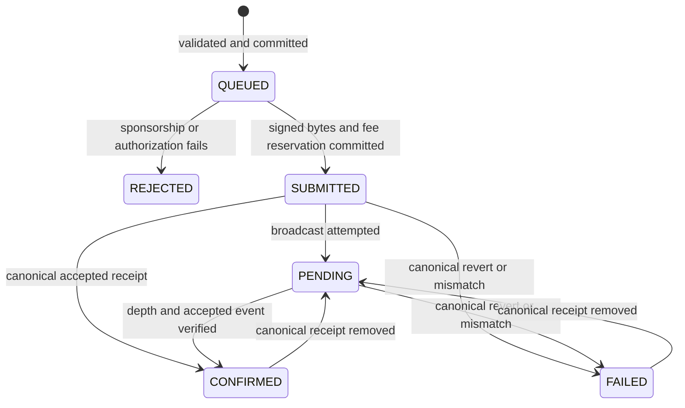

# Gasless voting, protocol version 2

Implemented for synthetic local experiments; see [evidence and open gates](../mvps/mvp-2.md). This version sponsors gas, not privacy. The voter still needs an EOA wallet and MetaMask authorization. No voter private key reaches NestJS.

## Contract and signed authorization

BasicVoting and its ABI remain the historical MVP 1 baseline. GaslessVoting is a new non-upgradeable deployment with the same administration, frozen eligibility/candidates, public tally and VoteCast interface. Both direct `vote` and `voteWithSignature` invoke `_castVote`. It attributes the actual voter, checks state/eligibility/candidate/unspent status, and atomically increments the tally and election-scoped nonce. The relayer's address is never voter identity. See [ADR 0008](adr/0008-gasless-signed-intents.md).

```text
Domain: name="HCMUT Gasless Voting", version="2",
        chainId=<configured chain>, verifyingContract=<new deployment>
VotingIntent(uint256 electionId,bytes32 manifestHash,uint256 candidateId,
             address voter,uint256 nonce,uint256 deadline)
```

The exact TypeScript schema/types are in `packages/shared-types/src/gasless.ts`. API integers are canonical unsigned decimal strings bounded to uint256. Candidate IDs are zero-based. The contract separately checks candidate range before narrowing to uint32. Signature encoding is the 65-byte EOA format. OpenZeppelin EIP712 and ECDSA verify the domain and recovered voter, reject malformed/high-s signatures, and bind all fields. Contract accounts/ERC-1271 and delegated EOAs with code are rejected by the sponsored path. No walletless flow is implemented.

`nonces[electionId][voter]` starts at zero and increments on either successful voting path. Failed transactions do not consume it. Multiple signatures for the same nonce are competing authorizations: the first accepted vote wins. A new signature does not revoke an earlier signature. The UI must not imply candidate changes invalidate a previously disclosed intent. Deadline is inclusive (`timestamp <= deadline`); the election's half-open window still applies. The manifest is frozen before signing, preventing metadata reinterpretation.

## API v1 additions

| Method/path | Contract |
| --- | --- |
| GET `/v1/gasless/config` | Enabled flag, fixed EIP-712 domain/types, deadline policy, EOA-only support; no signer secret/RPC credentials |
| GET `/v1/gasless/nonce/:electionId/:voterAddress` | On-chain nonce, block timestamp/hash and recommended signing deadline |
| POST `/v1/gasless/votes` | Strict `{ intent, signature }`; required `idempotency-key` equal to EIP-712 digest; returns durable request ID/status |
| GET `/v1/gasless/votes/:id` | Current chain-reconciled status, hash, receipt block/hash, actual gas/fees, sponsor and timing metadata |
| GET `/v1/gasless/intents/:digest` | Recover the request ID/status when the POST response was lost |

The client cannot select a contract destination, calldata, chain or transaction value. Invalid signatures fail before sponsorship. Admission verifies chain eligibility, active state, candidate, frozen manifest, nonce, deadline, EOA code and contract simulation. The worker repeats validation because state may change while queued. Error bodies contain stable codes and sanitized text. Codes include INVALID_SIGNATURE, INTENT_EXPIRED, INVALID_NONCE, ALREADY_VOTED, VOTER_NOT_ELIGIBLE, IDEMPOTENCY_KEY_MISMATCH, VOTE_REQUEST_EXISTS, RATE_LIMITED, QUEUE_FULL, RELAYER_BALANCE_LOW, SPONSORSHIP_BUDGET_EXCEEDED, GAS_LIMIT_EXCEEDED, GAS_PRICE_EXCEEDED and DEPENDENCY_UNAVAILABLE.

Signatures are not written to application logs. HTTP bodies are not logged. Request IDs/digests in localStorage allow reload recovery; neither signatures nor keys are stored there. Receipts and the surrounding election results refresh after confirmation; reorg demotion refreshes the surrounding election state too.

## Persistence and lifecycle

The additive migration `202610120001_gasless` creates four tables in the existing private `voting` schema:

- GaslessVoteRequest: domain, signed fields/digest, active slot, transient signature, status and timing.
- GaslessRequestHistory: append-only state transitions and sanitized errors.
- RelayerTransaction: nonce, signed hash/transient raw bytes, gas limit/price/reservation, canonical receipt and actual fees.
- RelayerBudget: conservative lifetime reservation for a chain/sender, bound to one contract deployment.



SUBMITTED means prepared durably; broadcast can still be uncertain. It never means accepted. A unique digest supplies idempotency. A nullable unique active slot enforces one live request for each domain/election/voter/nonce. Rejected/failed attempts release that slot but remain in history. Repeating the same digest returns its original result; a corrected request must use a new valid intent/deadline. Persistent voter/election attempt limits bound new variants.

PostgreSQL advisory transaction locks coordinate the chain/sender lane. Preparation stores the signed bytes and deterministic hash before any network send. Only one unresolved transaction exists per sender. The worker validates the stored transaction's sender, chain, destination, call selector, value and hash before re-broadcast. A process crash or failed DB commit cannot cause an untracked new broadcast. This implementation uses a bounded transaction timeout and bounded RPC calls; it holds a pool connection during each reconciliation step. The default five-connection pool and actual Supabase concurrency require validation before multi-process use.

Simulation and an integer 20% gas margin precede signing. Gas ceiling, gas-price ceiling, minimum balance and lifetime maximum-fee reservation apply. The admin key is prohibited as relayer. Reservations are not refunded after receipt, revert or reorg, conservatively bounding lifetime sponsorship under an honest database/configuration operator. RPC/storage/compute monetary cost is not measured by this counter.

## Failures, recovery and finality

The worker starts with the API, polls every second, and is also triggered by admission/status queries. It processes persisted queued and unresolved requests after restart. RPC/DB outages preserve uncertain state. There is no automatic freshly signed retry after revert, unknown replacement, timeout or reorg. Re-sending identical raw bytes does not allocate another nonce. Unknown provider errors are not logged verbatim.

Confirmation verifies receipt status, expected sender/destination/calldata hash, VoteCast voter/election/candidate, canonical block hash twice and configured confirmation depth. Status reads recheck confirmed/failed receipts. A reorg can demote either to PENDING; depth is not settlement finality. If the sender nonce is consumed but the expected receipt cannot be found, NONCE_CONSUMED_RECEIPT_UNKNOWN blocks the lane. PENDING_TIMEOUT remains nonterminal. Deadline expiry of an unresolved transaction also blocks the lane; it is not evidence that the transaction can never be mined.

Signatures and raw signed transactions are purged on terminal confirmation/rejection/failure, while their public on-chain calldata remains permanent. A later deep reorg after this purge requires operator reconciliation and may block the sender. Active unresolved records retain recovery material until reconciliation; do not silently delete them or reuse their nonce. Inspect the hash, canonical nonce, pending pool, deadline and original call before any manual replacement. Stop the sender before remediation. This version does not automate fee bumps, transaction cancellation or distributed failover. The administrator can also censor by cancelling the election.

Admission rate buckets are bounded, per process and do not retain IPs. Persistent attempt/queue limits and budget remain shared. A public deployment additionally needs ingress-level limits for read polling and invalid-signature floods, operational signer custody and RPC monitoring. No public deployment is performed here.

## Launch and migration

Use Node 24.21.0/npm 11.19.0 and the existing lockfile. No new package is installed. OpenZeppelin cryptography requires Cancun for MVP 2; MVP 1 retains Paris. See [local setup](../deployment/gasless.md). Existing chain addresses are never changed by a migration or automatically overwritten in `.env`. A new synthetic election and explicit contract configuration are required. Do not migrate an open election between protocols.

Future proof authorization can replace IntentAuthorization and the versioned contract while reusing the transaction transport and operational state machine. This does not implement or validate MVP 3 cryptography.
