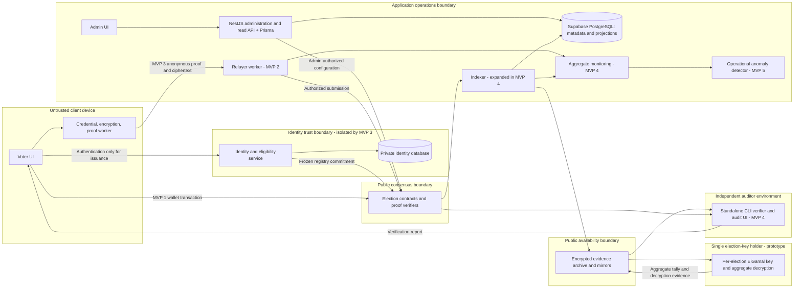
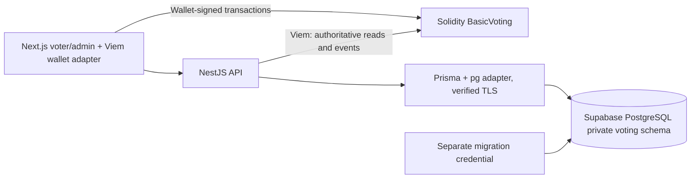
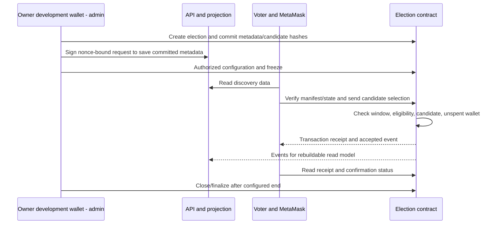
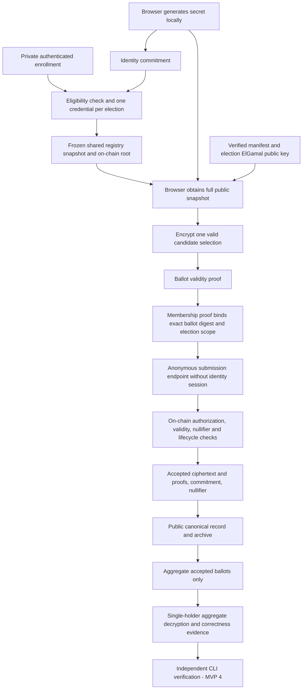
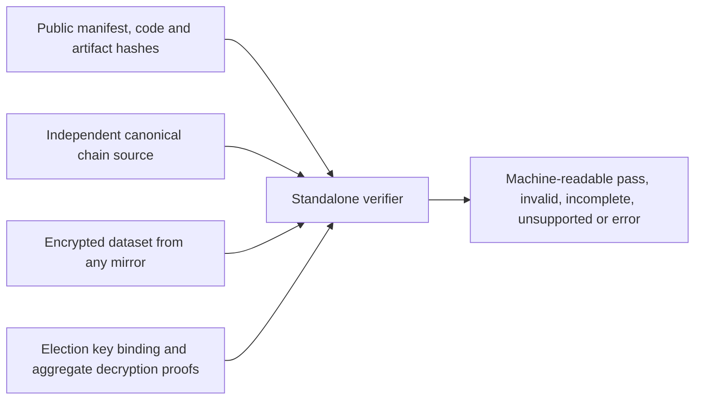

# System overview

Status: MVP 1 implemented locally; managed-database/real-wallet acceptance pending. Updated 2026-10-12. Later components remain proposed. Read the [ADRs](adr/README.md), [protocol](../protocols/voting-protocol.md), and [threat model](../security/threat-model.md) together.

## Context and boundaries

The research system serves synthetic voters, election administrators, eligibility officers, an initial election-key holder, future trustees, public auditors, and operations researchers. The target voter experience requires no wallet extension, cryptocurrency, or blockchain terminology. MVP 1 deliberately uses MetaMask as a public experimental baseline; MVP 2 removes voter fee payment but still uses wallet authorization. MVP 3 is the intended transition to browser-held anonymous credentials.

Blockchain provides a consensus-backed record of accepted submissions and election configuration under the chosen network assumptions. Supabase PostgreSQL holds metadata and rebuildable read models through Prisma in NestJS; no browser database access, Supabase Auth or Realtime is used. Identity data never belongs on-chain. A public archive holds cryptographic evidence. Initially one holder controls each election-specific ElGamal decryption key; independent trustee shares are a future extension. An RPC provider, an API response, or an explorer alone is not independent election verification.

## Target component diagram



Boxes express intended control boundaries, not a promise of operator independence. Initially a modular API may share a process with administrative eligibility logic using synthetic data. Before MVP 3, isolate identity issuance from ballot endpoints, databases, ingress sessions, and telemetry. Initial single-holder custody is explicit; key separation from the admin wallet does not establish independent operators. Future trustee shares must not be hosted by one operator and described as independent trustees.

## Responsibilities and introduction points

| Component | Responsibility | First milestone |
| --- | --- | --- |
| `apps/voter-web` | Voter/admin routes, candidate review, status, accessible confirmation | 1 |
| `services/api` | Election administration, authorization policy, typed read API, projection reconciliation | 1 |
| Shared rules | Contract owns lifecycle/eligibility; framework-free manifest encoding lives in shared types; no empty voting-core scaffold | 1 |
| `packages/contracts` | Lifecycle, authorization and uniqueness, accepted-vote events, later proof verification | 1 |
| `packages/shared-types` | Versioned API/event DTOs and runtime schema contracts | 1 |
| `services/relayer` | Sponsorship, intent validation, bounded queue, nonce management, retry, receipt/cost tracking | 2 |
| `services/identity` | Private eligibility decisions, duplicate issuance prevention, commitment registration | 3 |
| `packages/crypto`, `packages/zk` | Reviewed encryption/proof adapters, artifact versioning, browser worker boundary | 3 |
| Tally tooling | One fresh ElGamal key per election, aggregate decryption and proof generation; threshold extension later | 3 |
| Public accepted records and internal proof checks | Retain ciphertext/proof data and validate MVP 3 correctness; no standalone public audit claim | 3 |
| `services/indexer`, `packages/verifier`, `apps/audit-web` if needed | Reorg-safe indexing, complete evidence export, standalone verification and public view | 4 |
| Monitoring infrastructure | Prometheus/Grafana with privacy-preserving aggregates | 4 |
| `services/fraud-detection` | Offline training/evaluation and advisory operational alerts | 5 |
| `benchmarks` and chain adapters | Same workload across frozen protocol variants and L1/L2 environments | Baseline in 1, extended through 6 |

MVP 3 must generate decryption evidence and internally test encryption, validity and tally correctness while retaining publicly reconstructible accepted records. MVP 4 delivers the complete public audit dataset and standalone CLI verifier. Internal tests do not establish completed independent public audit.

## MVP 1 data flow



The browser receives only the public API origin and chain configuration. Prisma runtime and migration pools use separate configuration. The metadata schema contains no eligibility or authoritative result columns. See [ADR 0007](adr/0007-supabase-prisma-mvp1.md) and [API v1](api-mvp1.md).



For a future testnet demonstration, the owner's development wallet deploys/administers contracts while distinct synthetic voter wallets exercise authorization and duplicate prevention. Signing secrets are loaded from secure environment configuration, never committed. Local deployments are recorded in MVP 1 evidence; no public deployment was performed. The API cannot grant an unauthorized on-chain vote by changing a row. Public metadata is pinned by a manifest commitment. Chain time and contract checks determine acceptance, not the web countdown. The wallet's transaction sender and candidate are public. No real identity data is used in this baseline.

## Anonymous issuance and voting data flow (research design)



This flow is conditional on the cryptographic gate in [ADR 0003](adr/0003-anonymous-protocol-gates.md). It is not executable pseudocode. In particular, the message digest must bind all ciphertexts, election manifest, key, proof version, and ballot correctness evidence with one reviewed canonical encoding. Registry freeze prevents a voter from selecting a small personal root or switching credentials mid-election.

## Data ownership and publication

| Data | Location/owner | Publication and linkage rule |
| --- | --- | --- |
| Identity, eligibility evidence, contact/authentication data | Private identity service | Never on-chain or in ballot store; minimize retention; no shared session/request ID with voting |
| Issuance status and optional replacement-to-commitment record | Restricted issuer store | Needed only under documented pre-freeze replacement policy; cannot contain ballot ID/nullifier/choice; commitment knowledge still creates metadata risk |
| Credential secret and ballot randomness | Voter device | Never sent to issuer, relayer, logs, or public archive; encrypted client-controlled backup considered separately |
| Election manifest, candidate IDs, timing, protocol version | Public API/archive; digest on-chain | Immutable after freeze; include chain ID, contract address, election ID, key/circuit hashes |
| Registry root, public commitment snapshot | On-chain root; public archive snapshot | No real identifiers in leaves; full snapshot distribution reduces per-voter path-query leakage |
| Nullifier, ballot digest, acceptance event | Chain and public audit record | Public pseudonymous evidence; do not join to issuer datasets |
| Ciphertext and associated proofs | Initial MVP 3 proposal: transaction calldata plus public archive | Canonical replayable record; avoids a commitment-only availability assumption; no plaintext or opening randomness |
| Election decryption key | Single holder, secure configuration restricted to tally process | Fresh independent key per election; never use admin key or disclose secrets; holder can decrypt individual ciphertexts |
| Trustee shares - future mode | Separately controlled trustee storage | New election/key and reviewed setup; no retrospective protection for single-holder records |
| Final aggregate result and evidence | Public archive, result/dataset commitments on-chain | Authority-published and independently-verified statuses distinguished |
| Read projections and transaction status | API database | Rebuild from chain; include checkpoint block hash/finality; support rollback |
| Telemetry | Operations metrics store | Aggregate bounded labels; no identity/ballot joins, proofs, IP history, or request body capture |

On-chain calldata remains public even if application logs are deleted. Archival reconstruction requires access to historical data; a current RPC endpoint is not an availability guarantee. Mirror encrypted evidence and publish retention commitments before an election.

## Lifecycle and blockchain authority

Implemented MVP 1 lifecycle: `Draft -> Upcoming -> Active -> Closed`; `Cancelled` is terminal. Freeze produces Upcoming; start/end timestamps determine Active/Closed, and an explicit finalization flag records admin finalization. See ADR 0007. Freeze candidates, eligibility, policy, protocol version, time window, and (later) cryptographic parameters. Voting uses the half-open interval `[startTime, endTime)`. No votes after close, no reopening after tally, and no migration of a live election to another protocol or chain.

An administrator may cancel with a public reason under a documented policy, but cannot silently edit accepted ballots or erase history. Emergency stopping introduces a censorship assumption and must never be advertised as a neutral security guarantee. Tally only the canonical accepted set through a committed close block/checkpoint. Reorgs can invalidate provisional receipts: UI states distinguish `submitted`, `included`, `confirmed`, `finalized`, `reverted`, `dropped`, `replaced`, and `reorged`.

Use immutable versioned contract deployments, not upgradeable logic during an active election. Separate protocol versions in manifests and preserve prior ABIs/configurations for replay. A transaction hash is not a voter identity, an accepted vote, or a finality proof by itself.

## Public verification flow



The verifier obtains chain/deployment/close checkpoints independently, reconstructs accepted records, checks completeness and unique nullifiers, validates every applicable proof, recomputes the aggregate and checks decryption/result evidence. Missing data yields `incomplete`, never `pass`. The CLI emits versioned JSON and explicit non-success outcomes for missing, invalid, unsupported or failed checks. Real-world eligibility and single-holder key use remain trust assumptions; future trustee independence requires separate evidence. Voter inclusion demonstrates recorded-as-cast, not necessarily cast-as-intended on a compromised device.

## Monitoring and experimental architecture

The receipt collector records raw synthetic-run timings and fees in MVP 1. Later, indexer and relayer export bounded aggregate metrics. Model features come from permitted operational aggregates, never ballot contents or decrypted preferences. AI alerts have no contract authorization path.

A deterministic scenario generator supplies synthetic electorate/candidate configurations; a load driver records both logical ballots and transaction attempts. An independent collector reconciles receipt outcomes against finalized events; analysis consumes immutable raw runs. Store run manifests, hashes, code revisions, chain settings, hardware, and protocol versions. Detailed event timing is allowed only in labeled synthetic benchmark datasets and must not become real-voter telemetry.

## Staged layout and dependency direction

Proposed MVP 1 directories, created only when authorized:

```text
apps/voter-web/             # voter and admin routes in one app
services/api/               # modular API plus simple chain reconciliation
packages/contracts/
packages/shared-types/
packages/voting-core/
hardhat.config.ts          # local EVM; database is managed Supabase
benchmarks/scenarios/
benchmarks/results/
benchmarks/reports/
scripts/                   # reproducible run commands when implemented
```

UI/API/adapters depend on domain ports and shared DTOs; domain logic does not depend on infrastructure. Public verifier may use encodings and ABI definitions but must not import API database/repository implementations. Future service extraction must be driven by a trust or operational boundary, not directory symmetry.

## Selected key model and upgrade path

[ADR 0005](adr/0005-development-wallet-and-key-separation.md) permits the owner's development wallet for testnet deployment/admin during future authorized implementation. [ADR 0006](adr/0006-elgamal-aggregate-tally.md) selects client-side ElGamal with single-holder aggregate decryption initially. Signing, voter credential and election encryption keys are independent. Public encryption keys are frozen per election; secrets stay out of chain, frontend, logs and audit data.

The holder can decrypt individual ciphertexts regardless of normal aggregate-only workflow. A future threshold mode uses versioned public setup/proof formats and a new election/key with independent trustees. It cannot restore old ballot secrecy. The selected scheme is fixed; the concrete reviewed SDK/parameters and Semaphore/EVM compatibility remain gates in the [evaluation](cryptography-compatibility.md).

## Unvalidated hypotheses

Browser proof generation is usable on target mobile hardware; reviewed ballot validity proofs are economically enforceable on the selected EVM; the selected ElGamal validity/decryption proofs compose safely with membership messages; operational separation sufficiently reduces correlation; and L2 improves total cost under comparable security assumptions. None is validated by this architecture document. See the [decision register](../research/open-decisions.md).
